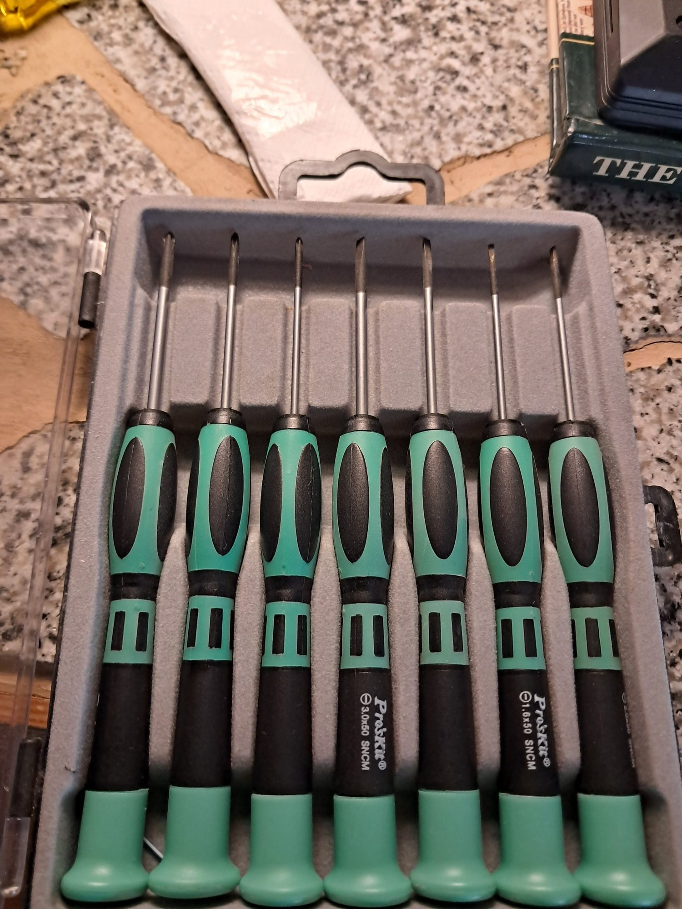
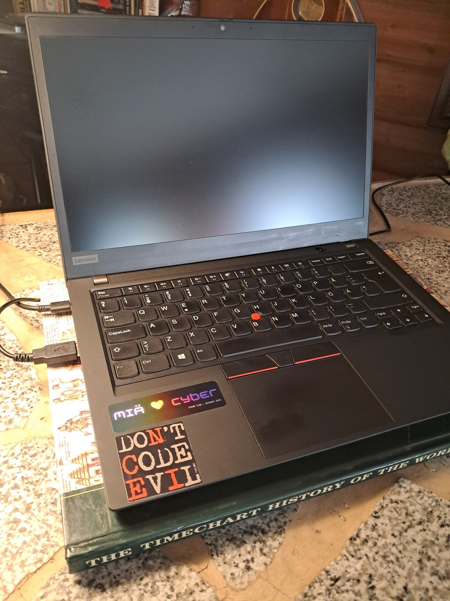
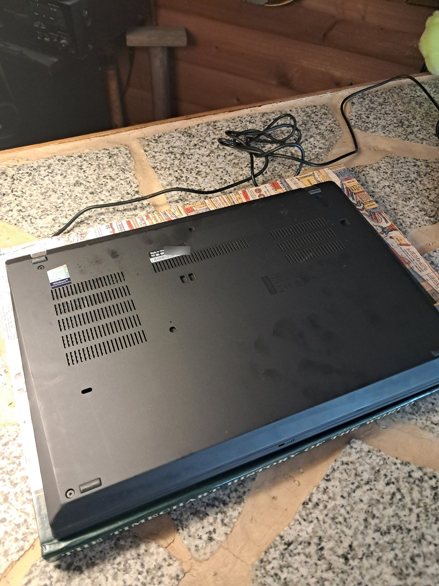
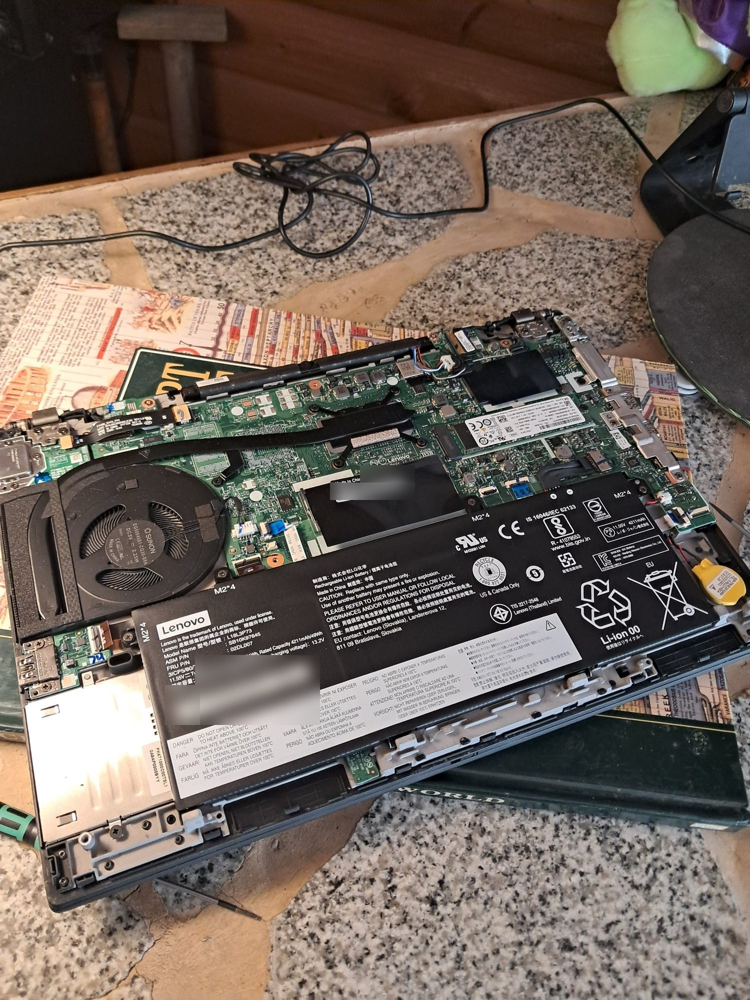
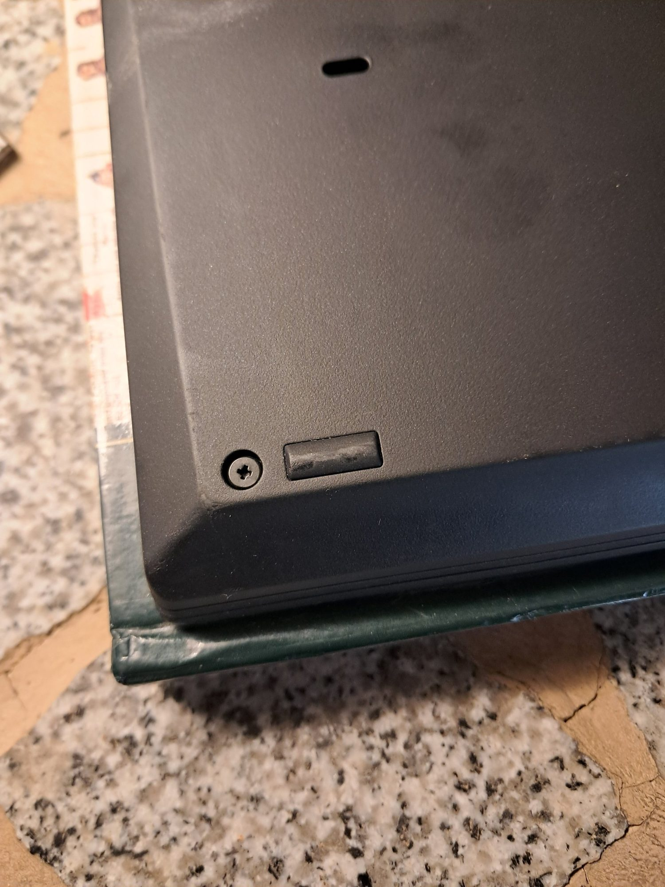
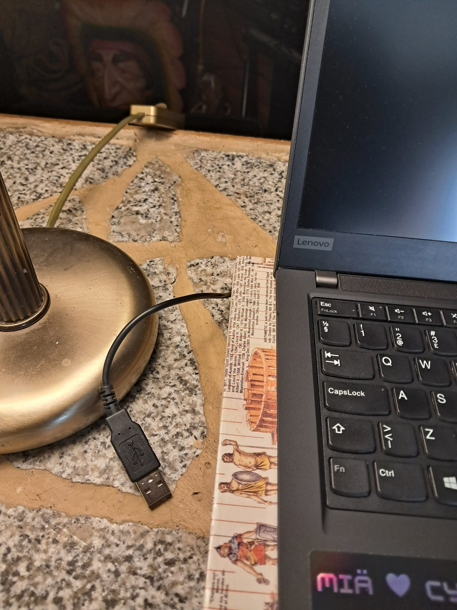
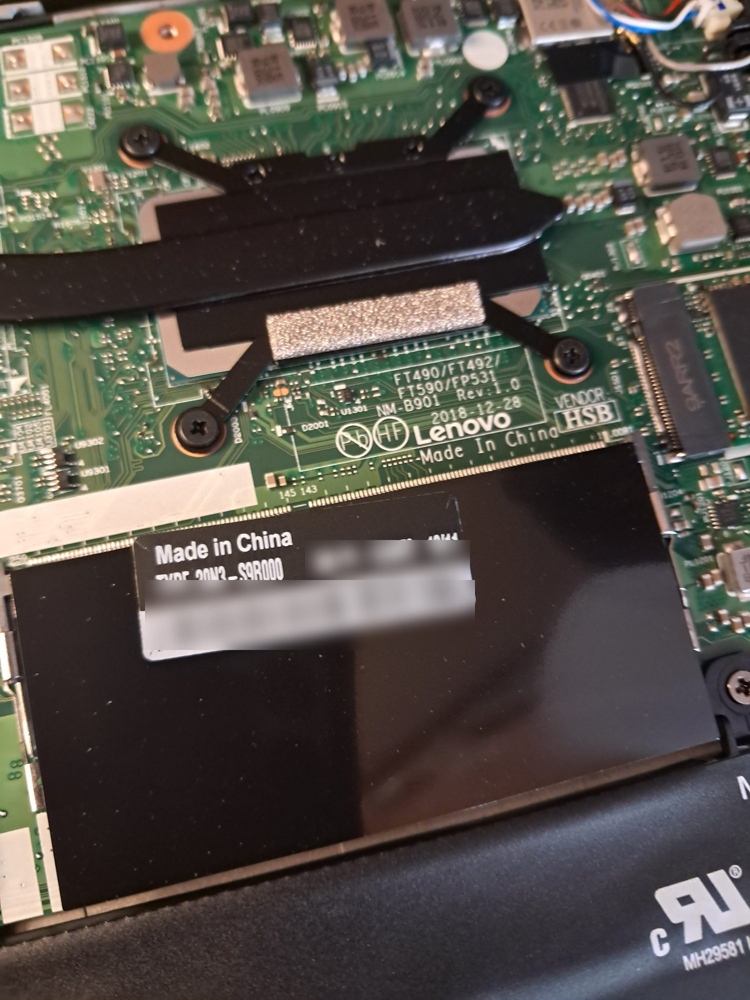
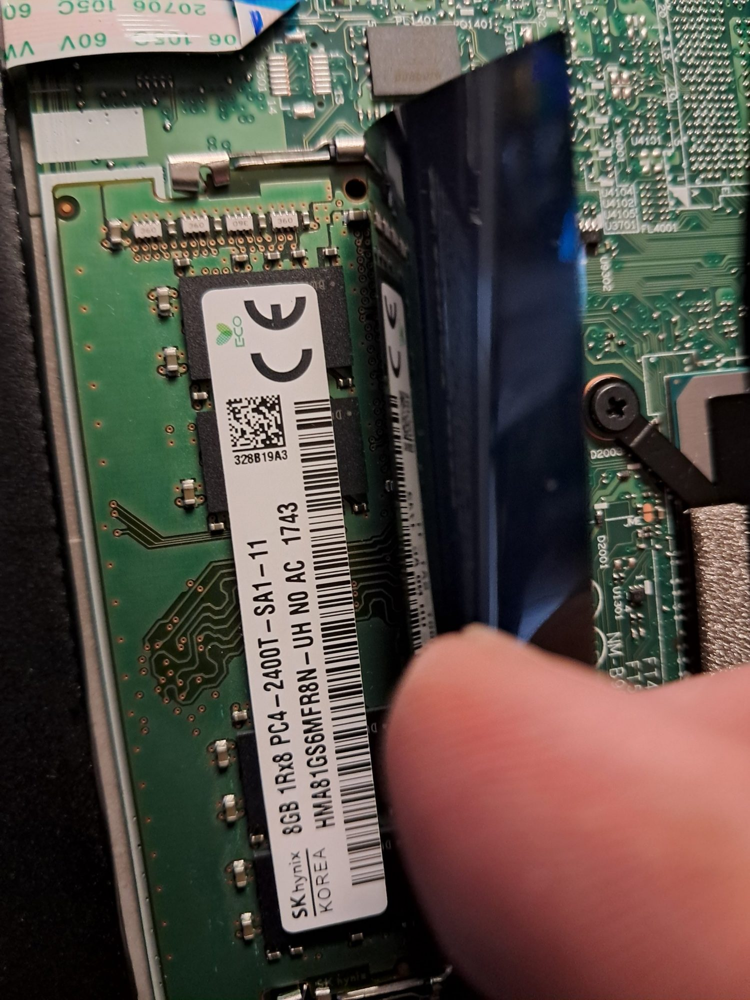
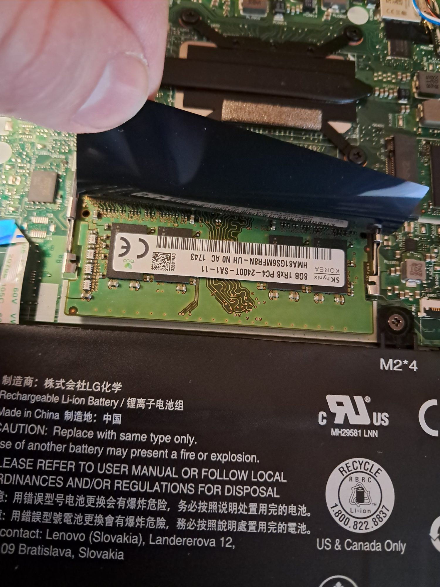

# Lenovo ThinkPad T490 – RAM Upgrade (8 GB → 16 GB)

Hardware maintenance report: adding an 8 GB SO-DIMM memory module to a Lenovo ThinkPad T490, increasing total memory from 8 GB to 16 GB.

| | |
|---|---|
| **Device** | Lenovo ThinkPad T490 (Machine Type 20N3) |
| **Task** | Install an 8 GB SO-DIMM module in the free memory slot (8 GB → 16 GB total) |
| **Date** | October 2026 |
| **Performed by** | Lari Venho |
| **Result** | ✅ Successful (one reseat required, see [Troubleshooting](#troubleshooting)) |

---

## Table of contents

1. [Objective](#objective)
2. [Hardware](#hardware)
3. [Tools](#tools)
4. [Safety precautions](#safety-precautions)
5. [Procedure](#procedure)
6. [Troubleshooting](#troubleshooting)
7. [Verification](#verification)
8. [Lessons learned](#lessons-learned)
9. [Photos](#photos)

---

## Objective

Increase the system memory of the laptop from 8 GB to 16 GB to improve multitasking and make it better suited for running virtual machines and other demanding tools. The T490 has 8 GB soldered to the motherboard and one free SO-DIMM slot, so the upgrade is done by adding a module to that slot. Using a module of the same size as the onboard memory also lets the memory run in dual-channel mode.

## Hardware

| Component | Details |
|---|---|
| Laptop | Lenovo ThinkPad T490, Type 20N3-S9R000 |
| Motherboard | Lenovo FT490/FT492/FT590/FP531, NM-B901 Rev 1.0 |
| Onboard memory | 8 GB DDR4, soldered to the motherboard (not replaceable) |
| Memory slot | 1 × DDR4 SO-DIMM slot, located under a black insulating film above the battery |
| **Installed module** | 8 GB DDR4 SO-DIMM (SK hynix, PC4-2400 label visible in [photo 9](images/09-installed-module-8gb.jpg)) |
| **Total memory** | Before: 8 GB → After: 16 GB |
| Battery | Internal Li-ion, Lenovo L18L3P73 (11.55 V, 51 Wh) |

## Tools

- Pro'sKit precision screwdriver set (Phillips + flat), see [photo 1](images/01-tools-precision-screwdrivers.jpg)
- Plastic pry tool / guitar pick (optional, for releasing the bottom cover clips)
- Clean, flat, non-static work surface

## Safety precautions

- Shut the laptop down completely (not sleep or hibernate) and disconnect the charger and all peripherals.
- The T490 has an **internal battery**. Lenovo recommends disabling it before opening the case:
  BIOS (F1 at boot) → *Config* → *Power* → *Disable built-in battery*. The laptop powers off and will not turn on again until the charger is connected.
- Discharge static electricity by touching a grounded metal object before handling components, and hold memory modules by their edges.
- Do not touch the gold contacts of the memory module.

## Procedure

1. **Preparation.** Shut down the computer, unplug the power adapter and all USB devices ([photo 2](images/02-thinkpad-t490-before.jpg), [photo 6](images/06-peripherals-disconnected.jpg)).
2. **Remove the bottom cover.** Turn the laptop over on a soft surface. Loosen the Phillips screws on the bottom cover ([photo 3](images/03-bottom-cover.jpg)). The screws are *captive*: they stay attached to the cover and only need to be loosened, not removed ([photo 5](images/05-captive-screw-detail.jpg)).
3. **Release the cover.** Gently lift the cover starting from the hinge side and work around the edges to release the clips ([photo 4](images/04-bottom-cover-removed.jpg)).
4. **Locate the memory slot.** The SO-DIMM slot is above the battery, covered by a black insulating film. The machine type label is on this film ([photo 7](images/07-machine-type-label.jpg)).
5. **Access the slot.** Lift the insulating film to expose the SO-DIMM slot ([photo 8](images/08-memory-slot-under-film.jpg)).
6. **Install the module.** Align the notch of the 8 GB module with the key in the slot, insert it at an angle of about 30° **all the way in** until the gold contacts are no longer visible, then press it down until the metal clips on both sides lock ([photo 9](images/09-installed-module-8gb.jpg)).
7. **Reassemble.** Put the insulating film back in place, refit the bottom cover, press the edges until the clips snap in and tighten the screws.
8. **First boot.** Connect the charger (required if the internal battery was disabled) and power on.

## Troubleshooting

| Symptom | Cause | Fix |
|---|---|---|
| Black screen on first boot after the installation | Memory module was not fully seated in the slot | Opened the bottom cover again, removed the module and reinstalled it firmly until both clips locked. The second boot was successful. |

> **Note:** After a memory change, ThinkPads may also show a black screen for a while during the first boot while the system performs memory training. If the screen stays black for a long time, check the module seating first.

## Verification

After a successful boot, the installed memory can be checked in several ways:

- **BIOS:** F1 at boot → *Main* → *Installed Memory*
- **Windows:** Task Manager → *Performance* → *Memory*
- **PowerShell:**

  ```powershell
  # Installed memory modules
  Get-CimInstance Win32_PhysicalMemory |
      Select-Object BankLabel, Manufacturer, PartNumber, ConfiguredClockSpeed,
          @{Name = "CapacityGB"; Expression = { $_.Capacity / 1GB }}

  # Total physical memory
  (Get-CimInstance Win32_ComputerSystem).TotalPhysicalMemory / 1GB
  ```

**Result:** The laptop boots normally and the total memory is 16 GB (8 GB onboard + 8 GB SO-DIMM).

## Lessons learned

- Make sure the memory module is fully inserted before pressing it down. A partially seated module is the most common reason for a black screen after a RAM upgrade.
- Captive screws on the ThinkPad bottom cover make reassembly easy, as there are no loose screws to lose.
- Disabling the internal battery from the BIOS before opening the case is a good habit for any internal work on ThinkPads.
- Serial numbers were blurred from the photos before publishing.

## Photos

| | |
|---|---|
| <br>**1.** Pro'sKit precision screwdrivers | <br>**2.** ThinkPad T490 before the upgrade |
| <br>**3.** Bottom cover | <br>**4.** Bottom cover removed: motherboard, fan, battery and SSD |
| <br>**5.** Captive screw on the bottom cover | <br>**6.** USB devices disconnected |
| <br>**7.** Machine type label on the insulating film over the memory slot | <br>**8.** Memory slot under the insulating film |
| <br>**9.** Installed 8 GB DDR4 SO-DIMM module | |
